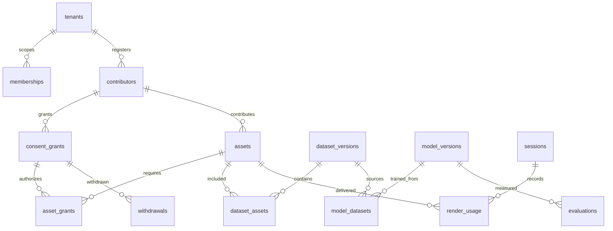

# Database foundation

`migrations/001_foundation.sql` targets PostgreSQL 16 and runs once in a transaction with `psql -v ON_ERROR_STOP=1 -f`. Use a migration role. The foundation HTTP API is stateless and does not connect to this schema yet. Application database wiring, migration automation, deletion jobs, royalty calculation, approval-state enforcement and tenant resource APIs are future work.

All tenant-owned relationships use composite foreign keys including `tenant_id` to prevent cross-tenant references. Forced RLS denies rows without a server-set tenant context. This is tenant isolation only, not user-level authorization: application code must verify membership, role, object ownership and consent purpose before changing records. A database user who can run arbitrary SQL and set tenant context is a trusted application role; RLS does not replace application authorization.

Use separate roles for migration, application, ingestion, review and reporting. Within a pooled application connection start a transaction, set the verified tenant via parameter-safe `set_config('app.tenant_id', value, true)`, then execute and commit/rollback. Do not retain tenant state across transactions. Never use a superuser, table owner or `BYPASSRLS` role for normal requests.

Consent grants are retained as evidence; revoke by timestamp plus withdrawal workflow. In the full implementation restrict direct updates and enforce append-only grant documents, allowed state transitions and separate release approvals. The starter schema does not automatically freeze models when a grant is revoked. Cross-check asset contributor/consent identity and purpose, language consistency, authorized approvals and signer-disjoint dataset splits in transactional domain services and tests before ingesting real data.

No video, landmarks, audio or transcripts are stored in these tables. Object references point to authorized encrypted storage; model/dataset manifests and evaluation reports carry versioned evidence. Royalty usage is idempotent event input, not a completed billing system. Use additive migrations, backup/restore tests and staged rollouts. A production downgrade must be written against real data rather than dropping this schema.
