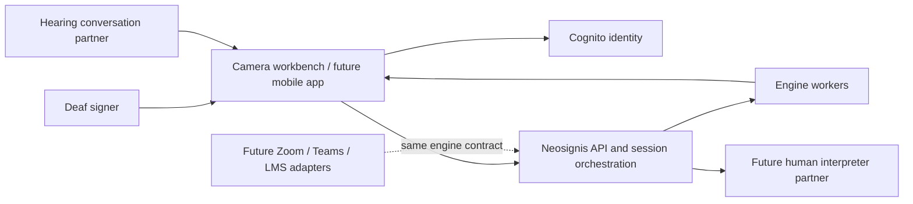
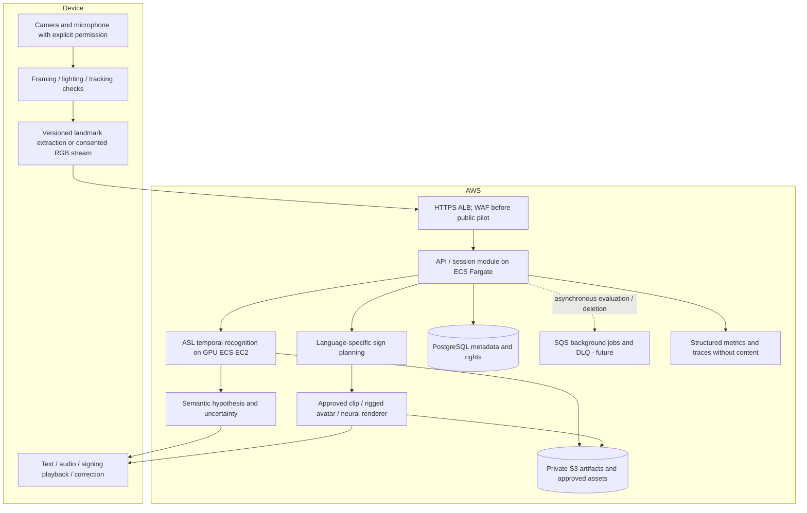

# Neosignis system architecture

The first deliverable is one platform-independent interpretation engine demonstrated through our own camera workbench. The engine recognizes ASL into text, then supports a bounded response-to-sign loop. AWS hosts reproducible environments; platform adapters are added only after the engine is measured.

The design is intentionally a modular API and independently scalable ML workers. It does not split every domain into a network service. Recognition and rendering need different GPU, memory and release characteristics, so they can become separate worker deployments when measurements justify that separation.

## System context

There is no meeting-platform dependency in the engine, training pipeline or semantic representation. The first application is the same API's first client.

## Runtime and data boundaries

Dashed boxes/connections denote later implementation. The diagram is the target system; [status](status.md) records which pieces actually exist. The foundation HTTP API transports short landmark utterances and text. RGB, streaming sessions, speech and actual rendering providers are not implemented yet.

## Inbound recognition

1. The client asks for camera permission and checks framing, both hands, upper body and face. Capture timestamps use a monotonic clock. The client records no video by default.
2. A versioned feature extractor produces landmarks with explicit missingness; a model trained on RGB additionally requires an explicitly consented RGB transport. Landmarks alone can lose cues and must be compared with RGB and hybrid baselines. Never silently substitute one representation for a model trained on another.
3. The orchestrator authenticates and authorizes the session, negotiates an approved language/model, enforces rate and payload limits, and routes to an available worker. A session pins an immutable model version.
4. The worker normalizes features according to the model manifest, segments the utterance, applies temporal recognition and translates the hypothesis into target text. Isolated-label classifiers and continuous translation are separate capability types.
5. The policy layer applies calibration and out-of-domain checks. It emits partial/final text, asks for repetition or abstains. It must never fill an uncertain visual interpretation using a language model's guess.
6. The client shows the text for correction. Optional voice uses a user-chosen TTS provider after text is committed; corrected text is not training data without separate opt-in.

## Outbound response and human-realistic signer

Typed response text or an ASR transcript becomes a semantic input with context and uncertainty. A language-specific planner maps meaning to signing syntax, spatial references, timing, body motion and non-manual signals. A gloss string alone is insufficient. The renderer realizes a reviewed sign plan through one of three backends: a complete approved phrase clip, a motion-driven rig, or a consented neural human renderer. No generic talking-head video model is assumed to preserve signing hands or facial grammar.

For the first loop, use an exact approved phrase/intent mapping and a consented full-phrase clip where available. This is labelled recorded signer output. It is not called an avatar. A realistic avatar milestone needs a licensed rig/identity, suitable motion, facial controls and comprehension evidence. Unsupported text returns an explicit unsupported result; arbitrary word-clip concatenation is not a signing grammar.

Conversation response generation is optional. The core interpreter translates what the hearing person says/types; it does not answer on their behalf. An optional assistant must be a separately labelled participant and cannot silently replace an interpreter.

## Components and deployment units

| Component | Responsibility | Initial deployment | Growth path |
|---|---|---|---|
| Camera workbench | capture, framing, text/correction, signer playback | local browser design, implementation pending | React/TypeScript web app; then mobile |
| API/session modules | identity, policy, routing, contracts, backpressure | FastAPI CPU container | ECS Fargate, 2+ tasks after durable session state |
| Recognition provider | validated ASL temporal model | no provider supplied | ECS GPU EC2 worker; per-model resource profile |
| Sign planner | intent/meaning to signing plan | no provider supplied | bounded phrase table, then evaluated language model |
| Rendering provider | plan to clip/motion/video | no asset/provider supplied | separate CPU/GPU worker as needed |
| PostgreSQL | rights, registry, memberships, jobs, metadata | versioned SQL only; optional RDS module | Multi-AZ and tested PITR before production |
| S3 | private model/data/asset objects | Terraform foundation | separate keys/prefix policies and regional strategy |
| Job queue | evaluation, ingestion, withdrawals | design only | SQS + DLQ; never queue live frames here |

## Technology decisions

| Decision | Selected approach and reason | Alternative and trigger |
|---|---|---|
| Application backend | Python 3.12, FastAPI/Pydantic; typed contracts close to ML ecosystem | Node/Go gateway if measured CPU/network constraints justify it |
| Web client | React/TypeScript design; camera/worker extraction separate from UI state | native apps after camera, thermals and accessibility requirements are measured |
| ML | PyTorch for experiments; benchmark ONNX/TensorRT export per model | keep native framework when export loses fidelity; neither runtime assumed installed |
| Database | PostgreSQL for transactions, lineage and entitlements | DynamoDB only if access patterns/scale justify another store |
| Containers | Docker, Compose locally; ECR immutable image tags in cloud | no Kubernetes until scheduling/operational requirements justify it |
| Cloud compute | Fargate for CPU API; ECS EC2 for GPU workers | managed inference/SageMaker if its economics and lifecycle fit; EKS later if necessary |
| Transport | short HTTP utterances first; bounded WebSocket feature stream next | WebRTC with TURN for RGB/audio/video once required; no custom media transport |
| Auth | Cognito OIDC, authorization-code + PKCE for public clients | organization's IdP federation later |
| Background work | SQS + DLQ design | no Kafka for initial scale |
| State | S3 encrypted/versioned state and native lockfile | Terraform Cloud if team workflow requires it |
| Observability | CloudWatch baseline; OpenTelemetry design | external platform after cost/privacy review |

Fargate currently does not support GPUs; GPU capacity is an EC2-backed ECS concern. [AWS Fargate FAQ](https://aws.amazon.com/fargate/faqs/). Terraform S3 state locking is opt-in with `use_lockfile`; versioning provides recovery history. [HashiCorp S3 backend](https://developer.hashicorp.com/terraform/language/backend/s3).

## AWS topology and environment strategy

Use a development account first; staging and production use distinct accounts and backend keys. Each environment owns a VPC, two public and two private subnets, security groups, registry and asset buckets. No use of Terraform workspaces as an authorization boundary. The dev root is implemented; staging/prod are designs and must not be cloned without their policy and recovery settings.

The foundation has no running compute by default. Enabling runtime adds one development NAT gateway, an internet-facing HTTPS ALB and private Fargate tasks. Enabling the GPU pool adds private GPU EC2 capacity with zero desired instances and zero worker tasks by default. Enabling PostgreSQL adds private RDS with AWS-managed master secret. NAT is a continuing charge once enabled. Production needs per-AZ egress or an evaluated endpoint-based design, two API tasks, Multi-AZ database, WAF, endpoint alarms and tested recovery.

Only HTTPS enters the public ALB. API port 8000 accepts the ALB security group only; worker port 8001 accepts the API group only; PostgreSQL 5432 accepts the API group only. No SSH ingress. EC2 uses SSM and IMDSv2. IAM separates execution roles, API application role, model read role and deployment role. Private Cloud Map names route workers; no worker public endpoint. Internal HTTP remains in the VPC for the dev foundation; mutual TLS/service identity is a pre-production requirement.

The GPU module is resource scaffolding, not an installed model runtime. Its image must implement the provider/worker contract. The default worker image starts but has no providers and reports unavailable. Neither GPU hosts nor models are started automatically.

## State, scaling and overload

The foundation is stateless HTTP and deliberately stores no sessions or signing content. The planned session orchestrator stores durable ownership/configuration in PostgreSQL and a bounded transient stream buffer on the active worker. Reconnection gets a new stream epoch and rejects frames from previous epochs. No promise of seamless session failover exists until tested. PostgreSQL is not a frame store.

One active stream pins one worker/model/version. Enforce per-user concurrency, queue length, frame age and total GPU memory. Autoscale by active streams and queue time, not CPU alone. Keep a warm pool only if measured cold starts and budget warrant it; a zero-size GPU pool means the system is unavailable until explicitly warmed. Drop stale frames with an event and preserve segment boundaries; never let a backlog accumulate indefinitely. Batch offline jobs independently from latency-sensitive live traffic.

## Proposed performance and quality objectives

Initial measurements report sign-end-to-final-text, first-result latency, text-submit-to-first-valid-sign-frame, P50/P95 per stage, abstention, signer/dialect coverage and cost per successful interpreted minute. A sub-two-second utterance-end-to-output target for bounded phrases is a hypothesis to test, not a guaranteed SLO. Continuous translation has different context/latency tradeoffs. Confidence is nullable until calibrated for that model/language/domain.

After measurement, set explicit thresholds and an admission limit for the tested hardware. Never use vendor accuracy headlines as Neosignis acceptance criteria. [Engine evaluation](engine.md) defines evidence gates.

## Failure handling

Unavailable model: 503 with a stable error code and no translated text. Unsupported language/domain: explicit rejection. Poor capture: ask for reframing/repetition. Uncertain semantic result: abstain and show correction/human options. GPU overload: 429 or 503 with retry guidance. Revoked signer: reject new renders and invalidate CDN/cache entries. Human provider unavailable: show unavailable, preserve text/correction and provide the configured human contact route; never show a false connected state.

## External interfaces

Recognize and Render HTTP contracts are executable. Converse, Escalate and Lexicon are specified in [streaming and API design](../contracts/streaming.md) and not exposed as fake successful endpoints. Adapters for Zoom, Teams, LiveKit, LMS, SDKs and smart glasses depend on the stable engine APIs and have separate platform review and transport tests later.
