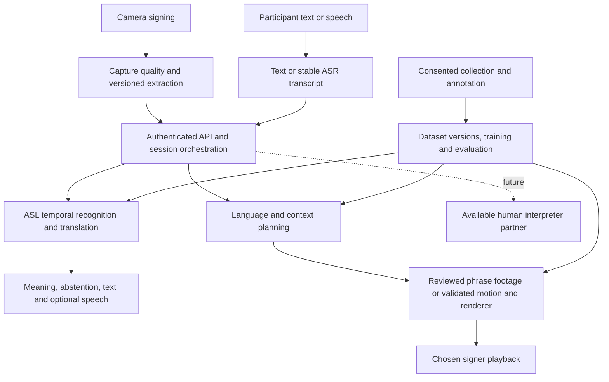

# Neosignis System Architecture and Delivery Plan

**Scope update, 18 November 2026:** the founder confirmed mobile + desktop browsers, in-person use, real-time ASL sign-to-text and text-to-sign as the successful MVP. The [MVP acceptance baseline](mvp-acceptance.md) governs release acceptance. Earlier camera, isolated-sign and one-direction milestones are intermediate steps.

**Version 2.0 — reviewed baseline | 16 November 2026 | Accountable owner: Technical Lead**

Revises the supplied Version 1.0 dated 13 November 2026 against `Neosignis/Infra-Setup`, branch `codex/local-camera-workbench`, commit `4b2d33ab271cf3d9fca9b4248dd2dc25e2782b71`, and the user's subsequent priorities. The feature branch remains an unmerged draft PR at review time. This document does not merge it, deploy infrastructure, approve data use or certify a model.

Read the [comparison and concerns](reviews/2026-11-16-architecture-plan-review.md) alongside this plan. The source document describes several components that are absent from the reviewed checkout; those descriptions have been corrected rather than carried forward as completed work.

## 1. Purpose, direction and evidence labels

The target product is an ASL-first two-way interpreter: a Deaf person signs an unseen message and is understood through text/speech; a hearing participant replies and receives understandable signed output through the user's chosen signer. Realistic contributor-based signers, independent NSL support, human escalation and later platform adapters remain the direction. The response is the participant's message, not an answer invented by a chatbot.

The camera workbench is an internal capture/review utility. A twelve-intent experiment may validate a small recognition pipeline; neither that experiment nor a recording screen satisfies continuous translation or the complete product MVP.

Status labels:

- **VERIFIED CODE:** inspected in the stated checkout; not necessarily deployed or operational.
- **VERIFIED CHECK:** a named local test or linked CI run passed; applies only to what that test exercises.
- **PROPOSED:** future engineering work or an approach to evaluate, not an implemented feature or an agreed spending commitment.
- **DECISION NEEDED:** a specific unresolved dependency such as budget, rights, model choice or reviewer availability.
- **CLOUD UNVERIFIED:** no account inventory, real AWS plan/apply or runtime deployment was verified by this review. Code defining a resource is not proof it exists.

Agreed priorities: engine before platform integrations; ASL first, NSL separately evaluated; everyday conversation as the initial exploration domain; reviewed recorded responses before a realistic-avatar claim. The November strategy's wider education/workplace/healthcare calendar remains strategic planning, not a measured engineering delivery commitment. The current budget is unset; potential contributors can be introduced. Named paid reviewers, licensed data, model weights and signer assets have not been supplied.

## 2. Current baseline: what exists and what does not

| Area | Inspected state | Evidence/limit |
|---|---|---|
| Runtime services | FastAPI gateway and private engine worker | `src/neosignis/api.py`, `worker.py`; two services, not four |
| Recognition/rendering | Typed provider interface with explicit unavailable defaults | `providers.py`; no trained recognizer, planner, clip renderer or neural renderer installed |
| Browser workbench | React/TypeScript/Vite capture, playback, discard and ZIP export | `apps/workbench/`; video stays in tab memory until downloaded; no extraction or inference |
| Authentication | Local development bearer token or Cognito access-token verification | `auth.py`; no `X-API-Key` authentication scheme |
| HTTP contract | Capabilities, recognition and render routes, health/readiness | `contracts/openapi.json`, `contracts.py` |
| Speech and English-to-ASL | Not implemented | No ASR integration, English-to-gloss rules engine or translation service |
| Database | PostgreSQL foundation migration with tenant RLS and rights/lineage/session/usage tables | `db/migrations/001_foundation.sql`; application not connected to it |
| AWS | Bootstrap and dev Terraform modules | State, network, storage, identity, registry, optional API/RDS/GPU; cloud unverified |
| CI | Application, workbench and Terraform jobs | Verified on the stated feature commit; includes real container/PostgreSQL checks in GitHub |
| Publication | Manual foundation-image build/push workflow | No automatic dev/staging/production deployment workflow |
| Data preparation | Source-candidate register, contributor brief, acquisition/engine study and capture ZIP validator | Planning/integrity tools; no ingested/approved training corpus |
| Human escalation, streaming, royalties | Design/schema foundations only | No partner dispatch, live session handoff, streaming runtime or royalty settlement |

Latest verified feature-branch CI: [run 43724239789](https://github.com/Neosignis/Infra-Setup/actions/runs/43724239789). Main remains at `3dd716e5b864dbef001e57f38e48c0b242122e7f`; feature work must not be described as merged main functionality.

## 3. Architecture principles

1. Build and measure real sign understanding before spending effort on meeting adapters or presenting the camera utility as the product.
2. Keep a modular API with independent model-worker release/runtime boundaries. Split recognition, planning and rendering into additional deployments only when measured scaling, isolation or dependency needs justify it.
3. Version capture features, HTTP contracts, linguistic plans and delivered media separately. A single gloss timeline is not sufficient for every layer.
4. A missing model returns unavailable. An installed model may abstain. Unsupported output must not become a guessed sentence or unrelated signing clip.
5. Approval attaches to a model/asset version, language, scope, rights and evaluation evidence. A boolean claiming an entire language is validated is insufficient.
6. Include hands, face, body, timing, spatial references and non-manual grammar in the model/data decisions. Landmarks reduce bandwidth; they are not anonymous or a guarantee of sufficient information.
7. Separate private training collection from live inference. Recording, training, motion, likeness and output distribution need explicit permitted purposes.
8. Use complete reviewed phrase footage first for the response proof. A moving skeleton is a debugging view, not evidence of a linguistically correct signer.
9. Keep a bounded live path with admission control, cancellation, ordering and backpressure. Durable queues are proposed for ingestion, annotation/export, batch rendering and withdrawals; no SQS implementation exists today. Internal bounded buffers may still be necessary for live processing.
10. Match compute to actual model requirements. CPU inference may suffice for a small model; GPU use is a measured decision. Cold starts and warm capacity must be measured separately.

## 4. System context and runtime flows

The following is the **target architecture**. Only the gateway, worker seam and camera capture/review client are implemented.



### 4.1 Sign to text/speech

Target: explicit camera permission → framing/quality checks → extractor matching the selected model → temporal model/translation → uncertainty policy → reviewable text → optional chosen voice. Recognition must preserve negation, questions, names, numbers, referents and relevant facial grammar. Do not repair uncertain visual evidence by asking a language model to invent a likely message.

Today the workbench produces recordings; it does not extract landmarks or call recognition. The HTTP API accepts already extracted short utterances. Model and extractor integration are pending.

### 4.2 Text/speech to signing

Target: participant text or a sufficiently stable ASR transcript → language-specific semantic/sign plan → supported approved phrase or motion → recorded signer, rigged avatar or neural human → playback. Preserve the source message and any corrected transcript. Cancelling or revising input must not leave stale signing playing as if it were current.

For the first loop, exact approved meanings may select complete reviewed ASL clips. Reject unsupported requests instead of constructing arbitrary sentences from unrelated word clips. Dropping English articles/be-verbs, moving question words or fingerspelling unknown words does not establish an ASL translator.

For open-ended generation, assess an appropriately licensed model and reviewed ASL pairs. Gloss can be an auxiliary notation, but the plan also needs temporal/non-manual/spatial information and linguistic validation. No speech provider or learned planner is selected/installed today.

### 4.3 Human escalation and live sessions

Target capabilities include stable session/model IDs, sequence/revision IDs, cancellation, reconnect, playback interruption, explicit uncertainty and a human option. These need implementation and tests. Do not display a human interpreter as available until an actual partner route, availability response and session handoff have been demonstrated. The database has starting tables; it does not supply this behaviour.

## 5. Service catalogue and actual API contract

| Deployment | Local port | Current responsibility | Future evolution |
|---|---|---|---|
| API | 8000 | Authentication, body limits, validated forwarding and result checks | Session/data modules, policy, quotas and optional speech adapters |
| Worker | 8001 | Trusted provider loading, contract/capability checks and serial admission | Real approved models; separate worker deployments where justified |
| Workbench | 5173 | Explicit video capture, required metadata, playback and export | Internal collection tooling; model-connected testing after extraction exists |

Compose contains `api` and `inference` using the shared foundation image. The local launcher also starts Vite and creates a fresh server-side development token. It binds all services to loopback for local testing. Keep the launcher running while the localhost demo is in use; a GitHub link or passing CI does not host the application. Do not stop a user's active demo as part of unrelated QA.

| Current route | Actual behaviour without an approved provider |
|---|---|
| `GET /healthz` | Process liveness, normally 200 |
| `GET /readyz` | Engine readiness, 503 when unavailable |
| `GET /v1/capabilities` | Authenticated capability listing; ASL/NSL disabled by default |
| `POST /v1/recognize` | Authenticated landmark request; unavailable capability returns 503 |
| `POST /v1/render` | Authenticated text/signer request; unavailable capability returns 503 |

Authentication uses `Authorization: Bearer ...`. Local dev tokens cannot be used with `APP_ENV=cloud`; cloud mode verifies Cognito signature, issuer, access-token purpose, client, expiry and subject. Database/object authorisation, shared-service authentication and a production browser login flow remain incomplete.

There is no implemented `/v1/speech-to-sign/text`, `/v1/speech-to-sign/audio`, `/v1/sign-to-text` or `/v1/languages` route. Converse/Escalate/Lexicon and streaming remain planned interfaces. Keep the actual OpenAPI as the HTTP source of truth; add future endpoints through explicit versioned design rather than renaming implemented routes in a document.

## 6. Contracts, payloads and approval

`neosignis.landmarks.v1` defines 33 pose, 21 left-hand, 21 right-hand and 478 face points; missing groups are null. All groups present means 553 points. Inputs are 2–300 frames with strictly increasing, zero-origin timestamps up to 10,000 ms, extractor version and a mirroring flag. The current JSON request body limit is **4 MiB**, not a 10 MB audio limit.

**Open blocker:** a measured synthetic transport fixture with 300 fully populated frames and compact JSON is 4,331,796 bytes, exceeding 4,194,304 bytes. This is not ASL data or an accuracy test. Resolve model-specific feature selection, frame rate, precision, compression/binary transport or bounds before claiming ten-second full-feature inference. Add a regression test against the selected real wire format; do not just increase limits without capacity/privacy analysis.

The current recognition result supplies final/abstained status, text or reason, model version and nullable confidence. Uncalibrated linguistic confidence must be null. The render result returns an authorised opaque asset ID and output kind when ready, or an unsupported reason; it is not a sign-sequence timeline or delivered video stream. Asset authorisation/delivery is still missing.

Proposed contracts: a versioned linguistic plan with provenance, timing, spatial/non-manual information and uncertainty; a renderer-specific input; and a media delivery descriptor. Preserve compatibility through explicit versions/adapters. Do not promise that a single immutable manifest will accommodate all future renderers without change.

Provider `approved` flags currently assert capabilities inside trusted code. Before real promotion, enforce server-controlled rights and evaluation records, artifact digests, reviewer identities, allowed language/domain, revocation and a rollback version. Language-pack JSON currently describes unavailable models; it is not a seed vocabulary/grammar implementation.

## 7. Data collection, storage and governance

Create five related data lanes: recognition video, continuous ASL/English utterance/dialogue pairs, signing-production annotations, motion/identity assets, and independent evaluation. ASL and NSL need separate source lineage, local expertise and release evidence. Identity swapping does not prove contributor-specific dialect/style.

The source-candidate register and detailed collection study are in `ml/data/source-register.json` and `docs/research/2026-11-15-engine-and-data-plan.md`. All registered external candidates remain pending; none has been downloaded or approved for training/rendering. Recheck source/version, code/weight/data licences, contributor rights, permitted derivatives and actual files before use.

Start with contributor introductions and a costed pilot, using `docs/data/pilot-contributor-brief.md`. Appoint a fluent Deaf ASL language lead and an independent reviewer; agree compensation, recording/training uses and retention before requesting recordings. Target an initial 100–200 accepted utterances across 3–5 development contributors to validate the process, not to claim a broad interpreter.

For a bounded diagnostic, the illustrative 12 meanings × 20 signers × 10 recordings plus 400 negatives yields 2,800 clips. Assign signers before collection, for example 12 train/four validation/four test; that small final cohort still limits claims. Natural sentences/dialogues and an unseen-composition challenge must be a separate track. Neither clip counts nor a proposed hours target guarantee model adequacy.

Collection must preserve face/upper body/both hands, original orientation, timestamps and actual media properties. The present recorder's ten-second cap cannot be used to truncate longer utterances; adapt collection tooling when the protocol needs longer clips. Label what was actually signed, separately from the prompt. Have fluent reviewers resolve ambiguities and valid variants. Include negative/out-of-scope signing, varied conditions and important confusing meanings.

### Storage boundaries — proposed

| Boundary | Contents | Access/retention |
|---|---|---|
| Dedicated private dataset storage | Quarantine, original media, annotations, features, immutable dataset manifests/splits | Contributor uploads restricted to authorised objects; ML reads approved releases; retention follows agreements |
| Restricted rights/identity storage | Permission evidence and contributor identity mapping | Separate from training access; named authorised roles |
| Model storage | Weights, digests, lineage and evaluation reports | Reviewed promotion/revocation and rollback |
| Approved signer assets | Recorded responses, motion, rigs and identity-conditioned assets | Purpose- and contributor-specific access/delivery |
| PostgreSQL | Metadata, review, provenance, permissions and state | Transactional service enforcement and forced tenant isolation |
| GitHub | Code, small schemas/configuration and non-sensitive documentation | No private footage, identities, model weights or confidential source documents |

Current storage code defines `models`, `assets` and `research`, not a permanent dataset or `renders` bucket. The research lifecycle expires objects after seven days and noncurrent versions after seven days. **Do not upload the permanent training corpus there.** Implement a durable dataset boundary and separately agreed lifecycle first; preserve temporary research retention.

Ingestion: permission/source record → short-lived upload authorisation → bounded upload/checksum/decode validation → technical QC → Deaf meaning/grammar review → rights approval → signer-aware dataset release → versioned extraction/training. The existing ZIP checker establishes integrity/metadata only. It does not decode video, verify actual consent, assign safe splits or judge ASL.

Use KMS/TLS, public access blocking and least-privilege roles. Short-lived upload URLs are not inherently single-use; finalisation must pin/check object version and digest. Record opaque asset IDs, source/signer/session, reviewed references, rights purposes/expiry, review status, split and extractor version. Keep identity mappings restricted. Versioning alone does not implement withdrawal: trace and handle raw/derived objects, historical versions, model dependencies, caches and backup expiry under agreed rules.

## 8. Existing SQL foundation and missing workflows

`001_foundation.sql` already defines tenants/memberships, contributors, consent grants, assets/grants, dataset/model versions and lineage, evaluation, sessions, withdrawals and render-usage events. It enables forced tenant RLS and uses tenant-scoped relationships. CI exercises migration and non-owner isolation. This is a starting schema, not a running data platform.

Required next work: application connection/roles, migration runner and additive migrations; verified membership and resource ownership; contributor/asset/grant identity and purpose consistency; allowed transitions; approval separation; signer-aware release checks; revocation propagation; deletion and backup handling; usage reconciliation and actual royalty calculation. Do not discard or defer the entire schema until the avatar milestone. Product/rights decisions should refine it before collection, while services enforce actual permitted use.

## 9. ML strategy, rendering and measurements

Default approach: audit suitable pretrained components and licensed data while building an owned, reproducible bounded baseline. Do not assume an available research checkpoint has suitable commercial rights, language scope, preprocessing, quality or runtime. Select the model/input combination together. Compare RGB/landmark/hybrid paths where practical; never resize another source's landmark array into our schema and call it compatible.

Every experiment records data/split digests, code commit, extractor and dependency/image versions, seed, base-weight lineage, hardware and outputs. Separate training from validation/calibration and locked final evaluation. Production promotion must require evidence, not a self-reported boolean. Foundation images do not contain CUDA/model dependencies, weights or suitable signer assets merely because a GPU Terraform module exists.

Output progression is evidence-based: full reviewed phrase footage → validated motion/rig where useful → neural realistic signer. A skeleton is an optional motion diagnostic. A rig can still sign incorrectly. For realistic output, independently measure handshape/contact, motion timing, facial grammar, referents, comprehension and identity/style. One photo is not evidence of learned signing style. The planned three-to-five-signer library and contributor royalties are future deliverables, not existing assets.

P50/P95 timing must define its clock: sign end to committed text; stable text/transcript to first meaningful signing; and end-to-end session delay. Report warm, cold-start, network, extraction, inference and rendering separately. The under-two-second bounded-interaction target is a proposal to test, not a guarantee. Optional GPU infrastructure has zero-task settings but no verified request-triggered wake-up/SLA; do not promise instant scale-from-zero conversations.

Budget using measured compute, idle/warm capacity, storage/versions/transfer, speech-provider charges, annotation and contributor compensation. Rendering may be expensive, but its dominance is unmeasured. The strategy's $0.15/minute hypothesis is not measured unit economics or an approved price.

## 10. AWS architecture: code versus deployment

| Module/root | Actual code | Qualification |
|---|---|---|
| `infra/bootstrap` | Protected versioned/KMS-encrypted state bucket | Does not create GitHub OIDC trust or image repositories |
| `infra/environments/dev` | Dev composition with explicit feature flags | Only implemented environment root; no shared platform/staging/prod composition |
| `network` | Two-AZ public/private subnets, SGs, S3 endpoint and optional single NAT | Two-AZ network does not guarantee application/database HA |
| `storage`, `registry`, `identity` | Private S3/KMS, immutable ECR repositories, Cognito | Cloud unverified; durable dataset storage still needs implementation |
| `api` | Optional one-task CPU Fargate API with HTTPS ALB | Requires certificate, digest-pinned image and tester CIDRs |
| `database` | Optional encrypted RDS PostgreSQL 16, managed master password, seven-day backups, deletion protection | Configured single-AZ; app DB wiring/normal roles remain pending |
| `gpu` | Optional ECS EC2 GPU worker/capacity provider and private discovery | Module exists; no real model/GPU runtime deployment verified |

Defaults exclude runtime/NAT/ALB, RDS and GPU modules. They still define foundation resources with possible charges when applied. A budget alert is not a spending cap. Region must be chosen after actual latency/residency/quota/cost requirements; `us-east-1` is not an approved current setting.

When API runtime is enabled without the GPU module, the configured worker discovery/worker service is not provisioned by another CPU-worker module. A CPU worker deployment or an explicitly configured alternative remains to be built for a cloud CPU-only engine. Healthy API startup in this state does not establish engine readiness.

GPU workloads should use an appropriate GPU-capable runtime; current Fargate does not supply GPU tasks. Our existing ECS EC2 module needs verified AMI, quota, CUDA/image compatibility, artifact loading and workload tests. [AWS task definition guidance](https://docs.aws.amazon.com/AmazonECS/latest/developerguide/task_definition_parameters-managed-instances.html).

Cloud rollout is a separate track: confirm account/region/budget → inspect current account/state → review concrete saved plan → apply approved foundation/data resources → verify access/retention/restore → deploy the selected engine only when needed. HTTPS, hostname/certificate and tester restrictions are prerequisites for remote access, not a final step after transmitting data. Follow `docs/infrastructure.md`; do not run the source document's nonexistent deployment flags/runbook.

## 11. Delivery pipeline, security and operations

Current CI runs Python/API checks, generated OpenAPI and repository checks, PostgreSQL migration/isolation, Docker/Compose build/boot, workbench unit/build/browser tests, Terraform formatting/validation and four mocked-plan tests. Green CI demonstrates these checks, not an AWS plan/apply, model accuracy or production readiness.

`publish-image.yml` is manually dispatched on main, selects API/worker, uses the `development` GitHub environment and configured OIDC role/region/ECR variables. It publishes a commit-tagged image and reports its digest. It does not apply Terraform or update ECS. Real role/environment configuration and a successful publication are not verified here. No `AWS_DEPLOY_ENABLED`, `deploy_services` or automatic four-image deployment exists.

Proposed CD: reviewed trusted-branch image build; scanned/tested model-specific image; digest promotion; saved Terraform plan with account/region/evidence; protected environment policy; controlled apply/deploy; authenticated smoke/load checks and rollback. Add staging/production roots and environment policies only with explicit account/operational decisions. Confirm branch protection through actual settings rather than assuming it from a document; no setting was changed in this review.

Security gaps to close before shared use:

- Tenant/user/object authorisation and production service identity/TLS; private network access alone is insufficient.
- Rate/concurrency policy, timeouts/backpressure and resource-limit tests beyond the current one-operation worker admission.
- An implemented model/asset approval and revocation boundary.
- Authorised media delivery and contribution upload/review services.
- Deliberate ALB/application route exposure: current ALB default forwards all paths, and gateway docs/OpenAPI/readiness are not currently blocked there. The worker disables interactive docs, but this is not a general gateway route filter.
- Content-free structured logs/traces, request IDs, stage metrics, actionable alert routing, recovery/restore and incident ownership. The full telemetry suite in the source document is not implemented.
- Verified secret handling, pinned model runtime/base-image/transitive dependencies and release evidence.

The database design uses an RDS-managed master password, but that does not establish a repository-wide promise that secrets can never enter state. `sensitive` redacts Terraform display; it does not by itself omit data from state. Use external/managed secrets, supported ephemeral/write-only patterns where appropriate, restricted encrypted state and a reviewed data flow. [HashiCorp sensitive-data guidance](https://developer.hashicorp.com/terraform/language/manage-sensitive-data).

## 12. Milestones and dependencies

Timings are planning windows to estimate after a costed data/model pilot. No month or week is a committed delivery date without dependency evidence. A Head of ML hire can improve capacity but is not an agreed prerequisite for starting source audits, intake, baseline code or evaluation design. Fluent language review remains indispensable.

| Gate | Deliverable | Dependencies | Exit evidence |
|---|---|---|---|
| E0 — engineering foundation | Current API/worker/workbench/contracts/CI | Existing source | Verified code/tests; explicitly no linguistic capability |
| E1 — rights, scope and evaluation design | Costed contributor pilot, source/model shortlist, approved protocol and locked evaluation policy | Introductions, language lead/reviewer, budget/permissions | Named roles, permitted purposes, agreed targets; no unreviewed source silently cleared |
| E2 — curated data and exact preprocessing | Accepted pilot corpus, provenance, technical/linguistic review, compatible feature path | E1; durable authorised storage before distributed uploads | Decodable reviewed recordings; release/split digests; golden extraction and payload-bound tests |
| E3 — real ASL recognition | Bounded model-derived sign-to-text with correction/abstention | E1/E2 or a separately approved existing-data/model route | Unseen-signer test, negative inputs, semantic/error/latency report; no scripted labels |
| E4 — bounded two-way exchange | E3 plus participant reply and complete reviewed ASL output | Playback rights, approved response set, media access | A real exchange, independently comprehended, with unsupported input/output handled honestly |
| E5 — continuous translation/generation | Longer natural utterances, novel compositions, context and evaluated language planning | Suitable paired corpus/pretrained route and expanded review | Independent sentence/dialogue tests; a classifier pass cannot substitute |
| E6 — realistic contributor signer | Motion/rig/neural comparison and contributor-specific identity/style | Reviewed motion, likeness/output rights, compute and E4 comprehension reference | Blind comprehension/style comparison, hands/face/timing and measured cost; honest output labels |
| E7 — controlled pilot | Reliability, accessibility, uncertainty/correction, rights/deletion, operational support and human route where advertised | Passed scope-specific language gates and operational/security checks | Consenting limited cohort, task success, recovery/withdrawal drills and incident ownership |
| E8 — channel adapter | Zoom/Teams/other transport | Relevant recognition/output quality, current SDK/policy checks and pilot safeguards | Measured media/permission flow, actual host/platform behaviour and fallback |

NSL follows its own E1–E7 evidence, data and reviewers; ASL approval does not activate it. Read-only platform policy research can run in parallel, but sending a prerecorded video into a meeting is not proof that the interpreter engine works. Server-rendered video is one adapter option, not a universal requirement for all possible meeting integrations.

Cloud C0 (durable collection storage) can proceed alongside E1/E2 once account/budget/access decisions are made. C1 (shared engine hosting) follows a measured need. Neither is a prerequisite for a valid local E3 experiment. ASR can be added after the typed response loop is meaningful; transcribing speech into an unvalidated gloss timeline is not the primary success criterion.

### How to achieve the next gates

1. Confirm language expertise, reviewer availability and rates through the prepared contributor brief. Freeze supported meanings/scenarios, reference-review policy and test ownership; record what remains unagreed.
2. Audit exact data/model candidates and rights. Keep candidate, research-only and product-approved sources distinct; obtain actual samples/schema before designing adapters.
3. Implement durable storage/intake and the SQL service layer. Test rejected permissions, contributor/grant mismatch, retries, corruption, revocation and versioned deletion; inspect the plan before any cloud apply.
4. Validate a 100–200-utterance process pilot, expand the signer-aware corpus and lock the holdout. Match extractor/training/runtime versions and resolve the measured payload problem before model integration.
5. Train/adapt a baseline with reproducible lineage; compare a simple diagnostic classifier with the separate continuous target. Add semantic error analysis, unknown/negative inputs and abstention/calibration evaluation.
6. Install the reviewed provider in an appropriate image, enforce promotion/digests and demonstrate camera-to-model text. A sparse contract fixture is only a software test.
7. Add complete reviewed responses, authorised playback and independent comprehension. Only then evaluate motion/realistic rendering and speech as further product capabilities.

## 13. Quality gates and review checklist

Reverified on 16 November: **54 Python tests**, **26 frontend unit/UI tests**, TypeScript/production build, OpenAPI drift and repository checks passed. Existing CI on the stated commit supplies **five simulated-camera browser tests**, Docker/Compose boot, PostgreSQL migration/isolation and **four Terraform mocked-plan tests**. These are separate suites, not 61 tests proving a translator. No fresh real AWS plan/apply or ASL/renderer quality evaluation was run.

Before each data/model release, verify rights, integrity, signer/session/near-duplicate separation, exact preprocessing, output/schema safety, error/abstain handling and reproducibility. Keep test fixtures separate from signing examples. Test the full selected payload and boundary failure cases, including the current measured dense-request mismatch.

Draft internal bounded-recognition targets from the collection study: macro-F1 at least 0.90 counting positive abstentions as misses; at least 95% semantic correctness among accepted outputs with at least 80% coverage; at most 5% false acceptance of negatives; P95 sign-end-to-final-text at most two seconds on named hardware. Proposed response comprehension: at least 90% in blinded fluent Deaf review. **These are not approved thresholds or achieved results.** The checked-in acceptance example remains null/not agreed; freeze actual sample/signer counts and thresholds before final evaluation.

For continuous translation and realistic rendering, define separate community-reviewed acceptance rubrics. Report counts, uncertainty intervals, per-signer/condition errors, negation/names/numbers/referents, hallucinations, corrections, task success and cost. BLEU/ROUGE/image similarity are supporting diagnostics, not universal release thresholds.

Milestone review checkmarks:

- [ ] Source commit, data/model/asset versions and permitted scope are identified.
- [ ] Relevant engineering checks pass with evidence; mock/synthetic and real-signing tests are distinguished.
- [ ] Dataset/weights/output/likeness rights and withdrawal responsibilities are established.
- [ ] Independent language evaluation passes the pre-agreed gate; failures/abstentions remain visible.
- [ ] Latency/coverage/cost use defined denominators and hardware/network conditions.
- [ ] Actual deployment/access/rollback evidence exists wherever a deployment is claimed.
- [ ] Documentation, status and user-facing capability labels match the demonstrated behaviour.

## 14. Immediate work plan and open decisions

For the next five working sessions, focus on: (1) this reviewed baseline and contributor introductions; (2) costed protocol/source audit and evaluation design; (3) dataset/intake specification and concrete AWS data plan if account access is authorised; (4) media/rights/split validation and exact preprocessing/payload regression; (5) reproducible training/provider scaffolding and the model/data acquisition decision. Record blockers rather than moving model-quality work behind an arbitrary cloud calendar. Paid collection follows agreed terms and availability.

Michael owns budget/account decisions and introductions; the agent supports specifications, code, data/ML infrastructure, test automation and evidence reports; fluent Deaf language experts own linguistic assessment with appropriate independence. These are responsibilities, not claims that a staffed team or partner contract exists. No credentials should be pasted into chat.

Decisions needed: named language lead/reviewers; costed compensation and collection scope; chosen model/data/input route; authoritative approval and retention/withdrawal rules; AWS account/region/budget and shared-runtime need; pilot support/human partner arrangements. Platform choice and NSL scheduling follow their own evidence.

## 15. Repository map and evidence

```text
apps/workbench/                 implemented internal camera recorder/reviewer
src/neosignis/                  gateway, worker, auth, contracts and provider seam
contracts/                     executable OpenAPI and streaming design
db/migrations/                 existing PostgreSQL foundation migration
infra/bootstrap/               Terraform state bootstrap only
infra/environments/dev/        current dev root; optional runtime/DB/GPU
infra/modules/                 network/storage/registry/identity/API/database/GPU
ml/                            language/model/evaluation specifications and source candidates
scripts/data/                  capture-integrity checker; ingestion/training tooling pending
tests/                         Python/API/auth/contract/concurrency/data/launcher tests
.github/workflows/             foundation checks and manual image publication
docs/                          reviewed plans, runbooks, research and evidence
```

Future directories such as `infra/modules/datasets`, `ml/preprocessing`, `ml/training` and `src/neosignis/data` are work proposals, not present implementations. Use additive changes and explicit contract/data migrations; do not overwrite working foundations to match an unverified diagram.

Evidence: [reviewed commit](https://github.com/Neosignis/Infra-Setup/commit/4b2d33ab271cf3d9fca9b4248dd2dc25e2782b71), [draft PR](https://github.com/Neosignis/Infra-Setup/pull/1), [verified CI](https://github.com/Neosignis/Infra-Setup/actions/runs/43724239789). Local supporting files: `docs/status.md`, `docs/validation.md`, `docs/infrastructure.md`, `docs/engine.md`, `docs/security.md` and `db/README.md`. The comparison report records unsupported source claims and remaining gaps, including gaps in our own code.
