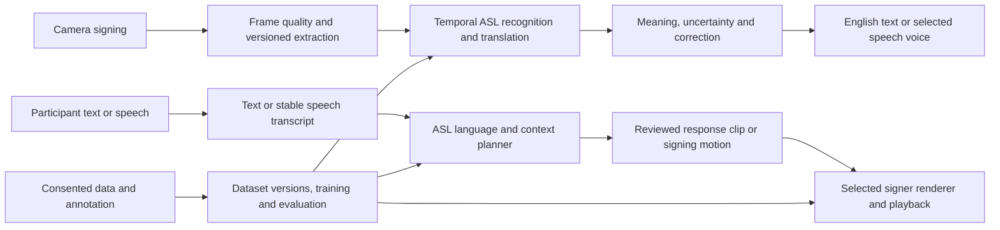

# Neosignis: competitor study and engine/data build plan

Research date: **15 November 2026**. Decision document for Michael and the Neosignis team. This is a proposed build plan, not a claim that models, datasets, AWS storage or partnerships have been delivered.

## 1. Recommendation and scope correction

Build an ASL-first, two-way translation engine supported by a managed data collection and evaluation process. Preserve NSL as a separate language/data/release track. Keep the existing camera workbench as an internal recording utility. Its camera, recording and export tests establish no sign-language understanding.

The product acceptance scenario is: a Deaf person signs an unseen message; the system returns the correct meaning as text or speech; a hearing participant replies; the system presents understandable ASL. The reply is the other participant's message, not an invented chatbot answer. Realistic rendering and contributor-specific style remain explicit product goals. Reviewed recorded responses can establish the output path while the renderer is developed, but must be labelled as recorded footage.

A twelve-intent classifier can test extraction, training and inference. It is not continuous ASL translation, the final MVP, or a replica of either company's full product. Record separate success criteria for this engineering experiment and the actual conversation system.

User constraints: ASL first, NSL designed in; engine before platform integrations; one developer working with the agent; first-month budget not set; potential contributors can be introduced. No purchasing, recruitment messages, dataset downloads or AWS deployment were performed for this study.

## 2. What the companies actually publish

These are public-source findings. No authenticated API inference, purchased dataset inspection, independent accuracy measurement or private source-code review was performed. Published availability is different from verified access to an account, model or dataset. Talksign's documentation host could not be retrieved with the research tool, so its exact callable API contract was not confirmed.

| Company/product | Published capability | Engineering lesson |
|---|---|---|
| Signapse: SignStudio | Production of ASL/BSL video for prepared content, with human quality checks described in its product updates | Build review/approval and content versioning, not just a render endpoint |
| Signapse: SignStream | Text-to-sign chat and developer streaming; individual instant translations are not reviewed before delivery | Separate instant experimental output from reviewed content |
| Talksign: Palm | Camera signing to English text/speech; public technical description of continuous ASL recognition | Recognition needs a temporal model trained on signed-language examples |
| Talksign: Echo | English text/speech to a photorealistic ASL signer | Translation, signing motion and rendering are separate problems |
| Talksign: Marketplace | Advertised contributor recording, review and commercial/research dataset licensing | The data supply chain is part of the product infrastructure |

Signapse's October 2026 update distinguishes SignStream's instant outputs from SignStudio's translator-reviewed outputs. Its public focus should not be treated as proof that it supplies the camera-to-text half of our system. [SignStream product update](https://www.signapse.ai/post/whats-new-with-signstream-our-real-time-sign-language-translator).

### Signapse's published technical approach

Its January 2025 BSL article describes text-to-gloss followed by gloss-to-video. It reports training on translated gloss sentences and collecting roughly 12,000 gloss recordings using about 30 cameras, including linguistic variants. This is a historical BSL description, not a verified specification for every current ASL product. It illustrates the substantial language and motion corpus behind the visible signer. Neosignis does not need to purchase such a studio to begin recognition. [Technical explanation](https://www.signapse.ai/post/how-does-our-ai-technology-work).

### Talksign's published technical approach

Palm's May 2026 article describes a 133-landmark spatial/temporal encoder-decoder Transformer, trained on over 71,000 examples. Echo's launch article describes speech recognition, English-to-ASL gloss, and motion-driven neural video rendering. These are vendor descriptions, not downloadable reproductions or independently validated architecture/quality evidence. [Palm technical article](https://www.talksign.co/blog/introducing-palm-1-0), [Echo technical article](https://www.talksign.co/blog/introducing-echo-1-0).

Echo's current page describes a 2,475-sign vocabulary and precomputed signs joined with transitions. It acknowledges limitations in sentence-level facial expression, signing space and role shift. Its reported visual benchmark uses 20 held-out signs/979 frames, with comparison values taken from different datasets. That is not a controlled head-to-head comprehension test. [Echo model page](https://www.talksign.co/echo).

Talksign's homepage promotes Palm 2.0 while its Palm page reviewed here still lists Palm 1.0 and describes Palm 2.0 as upcoming. Confirm the actual served model version before comparing products. Marketplace listings, availability and rights need verification of samples and an actual agreement; a displayed listing is not evidence we hold that data. [Homepage](https://www.talksign.co/), [Palm product page](https://www.talksign.co/palm), [Marketplace](https://www.talksign.co/marketplace).

### How we will judge the claims

The Palm article reports 36.6 BLEU-4 and 84.2 ROUGE. We must not relabel a text-overlap score as the percentage of messages correctly understood, or adopt a universal BLEU threshold for release. Visual similarity, frame rate and hand detection likewise do not establish correct signing. Evaluate both directions with fluent Deaf reviewers and an independent test set. The underlying metric publications explain BLEU and ROUGE as automatic reference-based measures. [BLEU paper](https://aclanthology.org/P02-1040.pdf), [ROUGE paper](https://aclanthology.org/W04-1013/).

## 3. The system we need to implement



The session layer coordinates turns, context, uncertainty and cancellation. It must not let a language model invent missing signs or silently rewrite an uncertain recognition into confident English. Represent abstention explicitly. For generation, a gloss sequence can be useful but needs timing, non-manual grammar, spatial references and linguistic validation; rearranging English words is insufficient.

Implement a small temporal classifier as a diagnostic baseline and a separate continuous sequence-to-text track for the product. Compare landmarks with RGB/hybrid inputs using the same holdout; landmarks can lose appearance/depth information. Fine-tune suitable, rights-cleared pretrained components where available instead of assuming that a new foundation model must be trained from zero.

Current `neosignis.landmarks.v1` has 33 pose, 21 left-hand, 21 right-hand and 478 face points: **553 points** when every group is present. Talksign's published 133 points and CLERC's 128 points are different feature definitions. They cannot be interchanged by resizing arrays. Freeze landmark indices, axes, handedness, mirroring, missing-point masks, timestamps and extractor/model versions together. Google documents 478 face landmarks and distinguishes subject-side left/right from mirrored input. [Face Landmarker specification](https://developers.google.com/edge/mediapipe/solutions/vision/face_landmarker).

## 4. Data we must gather

| Data lane | What to collect | What it trains or validates |
|---|---|---|
| Recognition | Natural ASL video from many fluent signers, equivalent English meaning, start/end boundaries and signer/session metadata | Incoming sign understanding and signer generalisation |
| Continuous translation | Whole signed utterances and short dialogues with context, reviewed English references, selected gloss/non-manual annotations | ASL-to-English sequence learning; new sentence compositions |
| Sign generation | English meaning/context paired with reviewed ASL sentence plans, signs, timing and spatial/non-manual annotations | English-to-ASL language planning |
| Motion and signer identity | High-quality signing footage, body/hand/face motion, identity assets and separate permitted uses | Readable signing motion and realistic contributor-specific rendering |
| Evaluation | Frozen unseen signers, new sentences, negatives, varied cameras/conditions and independent references | Release decisions rather than training |

An isolated-sign vocabulary corpus does not supply continuous translation. A keypoint corpus without raw video does not supply a photorealistic identity model. Permission to collect a clip does not establish training, output distribution or likeness rights. ASL recordings do not become NSL data by relabelling them. For NSL, recruit local fluent reviewers and record local linguistic variation independently.

For the planned contributor-specific signers, collect identity and *style* as distinct variables. Changing a face while sharing identical motion is not evidence that dialect, pace or linguistic style has been learned. Reserve contributor-specific style comparisons and comprehension tests for that claim.

## 5. Which outside datasets to assess first

| Source | Practical role | Published terms/limitation | Action |
|---|---|---|---|
| Our commissioned ASL recordings | Main product-domain and independent evaluation corpus | Needs agreed contributor compensation and purpose-specific permissions | Primary collection route |
| PopSign v1, Georgia Tech | Isolated-sign recognition/pretraining experiment | CC BY 4.0; not sentence translation or an avatar corpus | First public candidate to inspect for vocabulary and capture compatibility |
| ASL Citizen, Microsoft | Isolated-sign benchmark/research | Public terms restrict use to non-commercial, non-revenue-generating research; commercial inquiries available | Seek explicit commercial permission before product training |
| WLASL | Isolated vocabulary research/model comparison | Maintainer explicitly disallows commercial usage | Do not assume downloadable checkpoints are commercially usable |
| How2Sign | Continuous ASL/English research | Public release is CC BY-NC 4.0 | Commercial training needs a separately established permission route |
| CLERC Épée | Phrase/gloss/keypoint experiments and a commercial licensing inquiry | Public CC BY-NC-SA 4.0; 128-keypoint release; publisher offers commercial licensing, not raw signer video | Ask for exact commercial sample, schema, split and rights; does not solve signer footage |
| Talksign Marketplace | Possible purchased ASL/NSL dataset route | Website advertises licensed recordings and annotations; supply/rights not independently inspected | Assess on the same checklist as any supplier, including derivative model rights |

Primary dataset sources: [PopSign card](https://signdata.cc.gatech.edu/view/datasets/popsign_v1_0/), [ASL Citizen terms](https://www.microsoft.com/en-us/research/project/asl-citizen/dataset-license/), [ASL Citizen project](https://www.microsoft.com/en-us/research/project/asl-citizen/), [WLASL maintainer notice](https://github.com/dxli94/WLASL/blob/master/README.md), [How2Sign](https://how2sign.github.io/), [CLERC publisher](https://clerc.io/data), [CLERC dataset card](https://huggingface.co/datasets/CLERC-DATA/epee).

For each source: inspect actual files and vocabulary; record exact version, source URL, license evidence and checksums; verify permitted training, derived weights, redistribution and rendering uses; assess signer coverage and split leakage. Registry entries remain **pending** until this is done. Public hosting or an open-source code license alone is insufficient. Do not scrape social media or competitor output to create our corpus.

Model reuse also needs current review. OpenHands is a research reference, but its maintainer now states that it is no longer actively maintained. One available continuous-ASL research adapter, `mamounyosef/sign-language-bridge`, publishes weak results on a custom split and states training on How2Sign/OpenASL; its Apache-labelled model card does not settle all upstream data permissions. Assess candidates rather than promising a ready commercial interpreter. [OpenHands](https://github.com/AI4Bharat/OpenHands), [research adapter card](https://huggingface.co/mamounyosef/sign-language-bridge).

## 6. Collection process, beginning with a small pilot

**Before recording:** introduce potential contributors; appoint a fluent Deaf ASL language lead and an independent reviewer; agree scope, compensation, recording/training permissions and retention. Use the separate [pilot contributor brief](../data/pilot-contributor-brief.md). Do not ask a novice developer to supply ASL ground truth.

**First pilot:** target 100–200 accepted utterances from 3–5 contributors after those agreements. Validate capture, upload, annotation and reviewer disagreement. This is a collection-process pilot, not enough evidence for a broad interpreter. Treat its contributors as development participants and recruit the final holdout independently. Include a small set of reviewed full-sentence output clips with separately confirmed playback rights.

**Bounded recognition experiment:** an illustrative budgetable design is 12 reviewed meanings × 20 signers × 10 repetitions = 2,400 positive recordings, plus 20 negative/out-of-scope clips per signer = 400. At an assumed six seconds per clip, 2,800 clips contain about 4.7 hours of footage. Recording/review labour is substantially longer. The meanings remain proposed until reviewed; choose confusing pairs, negation and questions deliberately.

Assign 12 signers to training, four to validation and four to locked testing before collection. This gives 1,680/560/560 clips if balanced as above. Never put another recording of a test signer into training. Four test signers establish only a small internal experiment; expand signer diversity before claiming broad generalisation.

**Continuous translation corpus:** collect whole natural sentences and dialogues as a separate lane from the outset. Start with a 10–30-hour acquisition/annotation planning range across at least 20 contributors, then revise from learning curves, domain coverage and model reuse. This is a feasibility planning range, not a scientifically established minimum or a claim it will train a foundation model. Include an unseen-sentence-composition challenge in addition to unseen signers. Keep related sessions, duplicate sources and derived clips in the same split.

**Capture protocol:** stable camera/stand, face/upper body/both hands visible, proposed 1080p at 30 fps for the first controlled captures, clear lighting and enough space. Preserve the unmirrored original and measured timestamps. Record framing, actual frame rate, resolution, handedness convention and session/device ID. Later collect varied backgrounds, lighting, pace and occlusions deliberately. Start with consenting adults; a later minors protocol needs separate design.

Prompts express meaning and context, not English word-by-word instructions. Let signers use natural ASL, accept valid variants and record disagreement. Keep intended meaning separate from the observed reference interpretation. Fluent reviewers annotate the *actual* signing; a prompt must not automatically become the ground-truth transcript.

## 7. Ingestion and annotation

```text
Contribution and permission record
  -> short-lived upload authorisation
  -> private quarantine and checksum/decode validation
  -> technical quality review
  -> Deaf ASL meaning/grammar review and disagreement resolution
  -> rights-approved curated asset
  -> versioned signer-aware dataset manifest
  -> reproducible extraction/training
  -> frozen evaluation and model promotion
```

Each asset needs a pseudonymous signer ID, language/dialect where volunteered, session/source ID, recording time, object version, checksum, actual media properties, prompt/context, reviewed references, annotation status, permission/grant IDs, permitted purposes, expiry/withdrawal status, split and preprocessing version. Keep contact/payment documents in a separate restricted store.

Use a video annotation tool such as an appropriately configured ELAN/CVAT workflow after checking deployment/license requirements; tool choice is secondary to the annotation specification. Review boundaries, alternatives, key non-manual features, uncertainty and correction history. Use machine prelabels only as suggestions. Reviewers should not silently correct actual signing into the prompted sentence.

Build a deterministic media decoder/validator, not just a filename checker. The existing ZIP validator proves byte/metadata integrity, not decodable video, correct ASL or permission validity. Test wrong/corrupt files, timestamps, orientation, hand swapping, duplicates, unreviewed rights and mixed-signer leakage before ingesting a training release.

## 8. Where datasets should live

**Recommendation: private Amazon S3 for media/features/manifests, PostgreSQL for provenance/permissions/review metadata, GitHub for code and small non-sensitive schemas/configuration.** Use separate dataset, restricted rights/identity, model-artifact and released-signer-asset boundaries. These are logical/physical storage boundaries to implement, not buckets that already exist in an AWS account.

```text
Private dataset bucket
  quarantine/ase/<collection>/<opaque-clip-id>/original.mp4
  raw/ase/<collection>/<opaque-clip-id>/original.mp4
  annotations/ase/<dataset-version>/references.jsonl
  features/ase/<extractor-version>/<opaque-clip-id>.npz
  manifests/ase/<dataset-version>/manifest.jsonl
  splits/ase/<dataset-version>/signer-assignments.json
  raw/nsi/...                         # separate NSL lineage and review

Restricted rights/identity bucket
  grants/<opaque-grant-id>/<document-version>

Model artifact bucket
  ase/<model-id>/<version>/weights + manifest + evaluation

Approved signer-asset bucket
  <contributor-id>/<rights-version>/<asset-id>
```

Use server-issued short-lived, object-specific upload permissions; contributors do not receive AWS keys. Verify checksums, content limits and object metadata before finalising intake. Upload URLs can be reused before expiry, so use unique object keys, explicit finalisation/version checks and restricted credentials rather than assuming a URL is single-use. AWS documents presigned upload and checksum behaviour. [AWS upload guidance](https://docs.aws.amazon.com/AmazonS3/latest/userguide/PresignedUrlUploadObject.html), [presigned URL behaviour](https://docs.aws.amazon.com/AmazonS3/latest/userguide/using-presigned-url.html).

Configure public access blocking, TLS, KMS encryption, least-privilege roles and restricted cross-origin upload rules. ML jobs should read approved datasets without access to contributor contact/identity documents. Reviews and ingestion need separate permissions from model promotion. Retention must follow actual agreements; versioning is recovery protection, not a deletion implementation. Trace withdrawals through raw/derived data, object versions, backups and affected models.

Do not enable irreversible retention by default for contributor media. AWS Object Lock compliance mode prevents early deletion of protected versions; that can conflict with the withdrawal behaviour we intend to offer. [AWS Object Lock documentation](https://docs.aws.amazon.com/AmazonS3/latest/userguide/object-lock.html).

**Repository-specific finding:** `infra/modules/storage/main.tf` currently creates `models`, `assets` and `research` buckets in code. Its research lifecycle expires current objects after seven days and noncurrent versions after seven days. Do not use this as the durable training corpus. Add a dedicated dataset module/bucket and separately agreed lifecycle; preserve the temporary research purpose. No AWS apply was run or deployed storage verified.

Before distributed collection, prepare the S3/KMS/IAM/upload and metadata path. For an initial supervised local capture only, private encrypted local storage with an encrypted backup can be temporary staging, outside Git; it is not the shared system of record. GitHub, public Hugging Face repositories and chat attachments are unsuitable destinations for our private signer footage.

At a planning bitrate of 8 Mb/s, one hour is about 3.6 GB; the 4.7-hour example is about 16.8 GB of original video. Multiple views, proxies, versions and backups increase this. Measure actual exports. Estimate monthly cost from chosen region, stored GB, requests, transfer, review labour, annotation, training GPU-hours and any provider charges. No dollar quote or spend is authorised by this plan.

## 9. Training, tests and review gates

Store reproducible PyTorch training code and Docker recipes in Git. Pin data-manifest digest, split manifest, preprocessing version, seed, code commit, dependency/image versions and base-weight lineage for every run. Store weights and reports in S3; track experiments with a simple local MLflow setup or structured run files initially. A managed ML platform is optional. Use a bounded GPU job only after the model's measured need justifies it; do not run an always-on GPU pool for data collection.

| Layer | Automated check | Evidence beyond unit tests |
|---|---|---|
| Intake | size/type/checksum, safe paths, decode, duplicate/retry handling, authorisation | real device captures and restored backups |
| Rights/lineage | unreviewed/revoked/expired samples excluded, artifact dependencies traced | reviewed permissions and withdrawal drill |
| Extraction | golden video, exact point order/units, mirror/hand/missing-frame cases | visual and measured feature quality |
| Dataset release | no signer/session/duplicate leakage; fixed manifests | reviewer agreement and sample audits |
| Recognition | deterministic golden examples, empty/busy/error/abstain paths, correct model digest | held-out signer/condition results and semantic review |
| Continuous translation | repeatable decoding and reference-based metrics | unseen sentences, names/numbers/negation/referents and task success |
| Sign output | exact approved clip mapping, rights/version checks, no fallback to unrelated signs | blinded Deaf comprehension and grammaticality review |
| Realistic rendering | timing, motion/identity version, hand/face regression checks | comprehension versus recorded human baseline and style authenticity |

Proposed internal bounded-demo targets, **to agree before looking at test results**: macro-F1 at least 0.90 counting abstentions as missed positive examples; at least 95% semantic correctness among accepted outputs alongside at least 80% coverage; at most 5% false acceptance of negative/out-of-scope examples; P95 completed-utterance-to-text latency at most two seconds on named hardware. Report sample counts, per-signer/per-meaning results and uncertainty intervals. A conservative system cannot pass merely by refusing everything.

For reviewed response output, propose at least 90% blinded meaning comprehension by independent fluent Deaf reviewers, with confusing/negated meanings reported separately. These are draft internal targets, not measured results or clinical/production approval. Continuous translation requires its own frozen test set and community-agreed acceptance rubric; passing a twelve-label classifier cannot satisfy that gate.

For every release report critical meaning reversals, hallucinations, abstentions, corrections and task completion. Define latency clocks for capture, extraction, inference, rendering and network; do not compare a vendor's text-planning latency with our full end-to-end delay. Do not show a numeric probability as calibrated confidence until tested.

## 10. Concrete next work and repository locations

The paths below are **proposed implementation locations**, except the documents and source register delivered with this study.

| Work package | Proposed location | Completion check |
|---|---|---|
| Prompt/annotation specification and contributor pilot | `docs/data/`, `ml/data/` | language lead approves prompts, review method, compensation/permissions and pilot sample plan |
| Durable data storage and uploader roles | `infra/modules/datasets/` | plan reviewed, real upload denied outside scope, durable retention and deletion/version drill verified |
| Intake/review services | `src/neosignis/data/` | authorised idempotent upload finalisation; raw-to-approved workflow; existing SQL metadata wired to service |
| Validation, deduplication, split and manifests | `scripts/data/` | reproducible accepted release; rejected corrupt/rights-invalid samples; no signer leakage |
| Extractor and feature contract | `ml/preprocessing/`, `contracts/` | identical versioned preprocessing for training/inference and golden-video tests |
| Bounded diagnostic and continuous baseline | `ml/training/`, `ml/evaluation/` | real model artifacts, fixed evaluation and honest limitations |
| Runtime provider integration | `src/neosignis/providers.py` plus `src/neosignis/engines/` | real camera input produces model-derived text; unsupported input abstains |
| ASL planner, signed response and realistic renderer | `ml/generation/`, runtime adapters, `apps/workbench/` | reviewed output comprehension, then rendering/style gate |

Order: (1) contributor introductions and costed brief; (2) source/rights audit and exact initial scope; (3) durable storage/intake/annotation; (4) first 100–200 reviewed utterances; (5) reproducible actual-model experiment and independent holdout; (6) a real two-way conversation demonstration; (7) continuous coverage and realistic signer development, with separate evidence gates. Signup/Zoom/Teams are not on the critical path for recognition.

This week can advance specifications, source audits, contributor scoping, infrastructure planning and the training/evaluation code. Actual data collection depends on agreed compensation/permissions and reviewer time. A credible continuous translator and personalised neural signer cannot be scheduled as finished until model access, data and measured learning progress are known.

## 11. Decisions and responsibilities

Agent/technical work: prepare specifications, sourcing register, ingestion and storage changes, preprocessing, training code, provider adapters, automated tests and readable reports. Michael: introduce contributors, agree a pilot budget/compensation and provide AWS account/region/deployment access through the normal secure setup when cloud storage is authorised. No passwords or keys should be pasted into chat. Fluent Deaf experts: validate language, annotate disputed examples and judge comprehension; software tests cannot replace that role.

Before spending or collecting: settle reviewer availability, a costed pilot, authorised data/likeness purposes and storage location. If a full conversation demo is required before we can collect/train suitable data, assess a licensed external engine as a clearly disclosed temporary comparator/integration route. It does not become a Neosignis-owned model, and vendor access/terms must be confirmed first.
